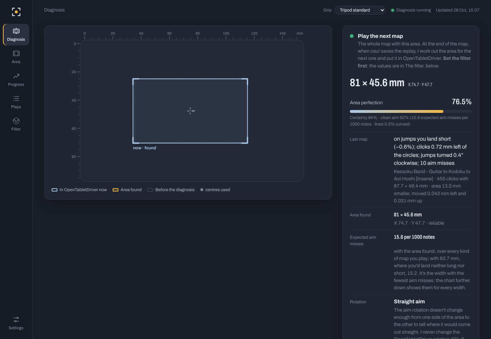
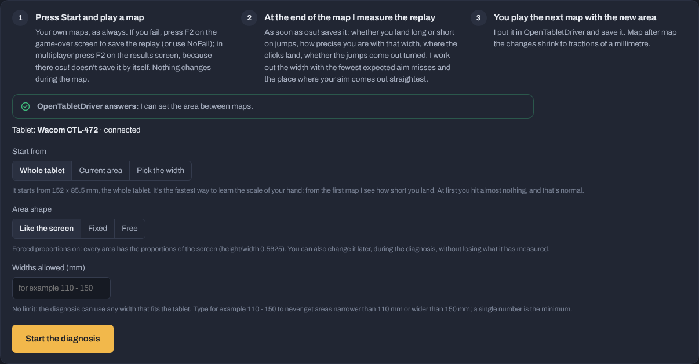
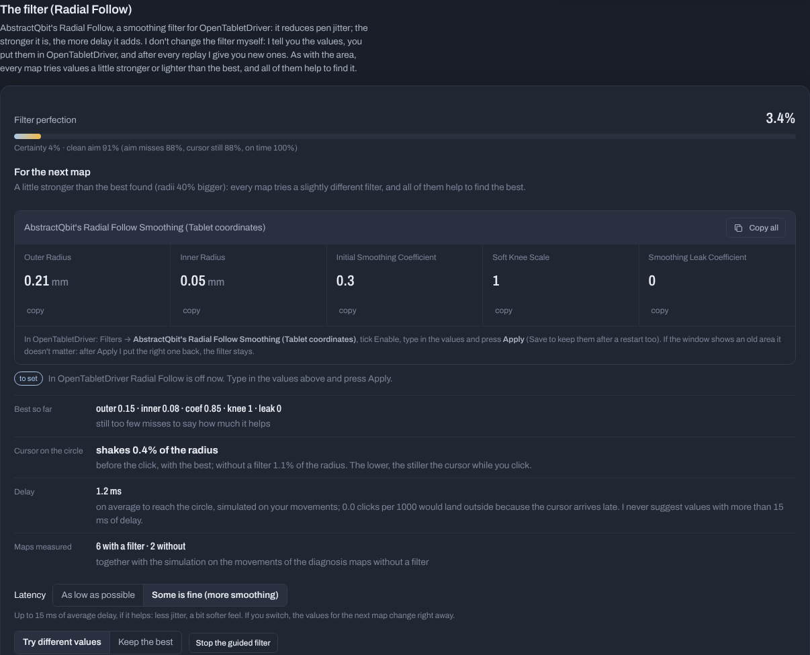
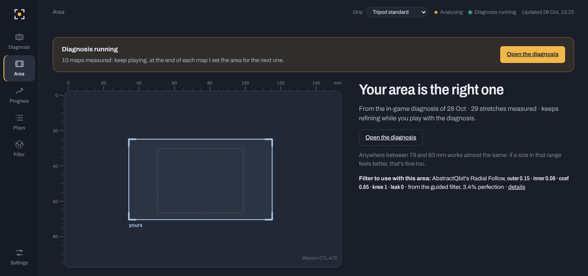
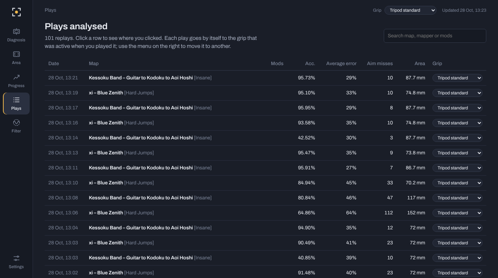

# Area Coach

**Area Coach finds the tablet area that fits your hand in osu! (stable).**
You play your own maps; after each one it reads the replay, measures how you aim and
sets a better area in OpenTabletDriver for the next map. Map after map the changes get
smaller until the area settles on the one you are most precise and steady with.

It can also help you tune AbstractQbit's **Radial Follow** smoothing filter for
OpenTabletDriver.



- [What it does](#what-it-does)
- [What it reads and changes](#what-it-reads-and-changes)
- [Requirements](#requirements)
- [Install](#install)
- [First start](#first-start)
- [The diagnosis, step by step](#the-diagnosis-step-by-step)
- [The guided filter (Radial Follow)](#the-guided-filter-radial-follow)
- [The other pages](#the-other-pages)
- [Troubleshooting](#troubleshooting)
- [Build from source](#build-from-source)
- [License and credits](#license-and-credits)

## What it does

- **In-game diagnosis.** You play normal maps, each one from start to finish with a
  single area. When osu! saves the replay, Area Coach measures it: whether you overshoot
  or undershoot jumps, how precise you are with that width, where your clicks land
  against the circles, whether your movements come out turned (wrist rotation), how
  straight the paths between circles are. Then it works out the width with the fewest
  expected aim misses and the place where your aim comes out straightest, and puts that
  area in OpenTabletDriver before you start the next map.
- **Every map tries something slightly different.** The next map is played with the best
  area found so far, a little bigger or smaller in turn; every two maps it is also moved
  a little to one side. That is how it learns which width and which place you are
  steadiest with. The tries get smaller as it gets surer.
- **A "perfection" percentage** says how close the area found is to a perfect one: how
  sure the diagnosis is, times how clean your aim is with it.
- **Guided filter.** For Radial Follow it tells you which values to set for the next map;
  you set them yourself, and after every replay it gives you new ones, until it finds the
  values that help you most.
- **Replay analysis.** Even without the diagnosis, it reads all your local replays and
  shows how you aim, which area your replays point to, your progress over time and every
  play in detail.

The interface is a local web page shown in its own window.

## What it reads and changes

Area Coach works only with files and with OpenTabletDriver:

- it **reads files** osu! has already written: replays (`Data\r` and `Replays`),
  `osu!.db`, the `.osu` map files and the osu! config file;
- it **changes the tablet area in OpenTabletDriver** (through OpenTabletDriver's own
  local connection and its `settings.json`), only between maps, as you would by hand.
  The first time it saves a copy of your original file as
  `settings.json.areacoach-backup`. Your filter settings are only read, never changed.

It doesn't interact with the osu! game itself, and nothing changes while you are playing
a map.

## Requirements

- **Windows 10 or 11.**
- **osu! stable** (not lazer).
- **[OpenTabletDriver](https://opentabletdriver.net) 0.6.x**, running, with your tablet
  in **Absolute Mode**. The Wacom driver must not be using the tablet at the same time.
- In osu!: mouse **sensitivity 1.0** and "Map absolute input to window" off (the program
  warns you if they are not).
- Optional, for the guided filter: the **AbstractQbit's Radial Follow Smoothing** plugin
  (OpenTabletDriver → Plugins → Plugin Manager).

The window uses Microsoft Edge **WebView2**, already part of Windows 11 and of most
Windows 10 installs. Without it the interface opens in your browser instead, with a small
window you keep open while you use it.

## Install

1. Download **[`AreaCoach.exe`](../../raw/main/AreaCoach.exe)** (it's also in the file list
   at the top of this page: click it, then the download button).
2. Put it wherever you like (Desktop, a folder of your tools…). There is no installer.
3. Start OpenTabletDriver, then double-click `AreaCoach.exe`.

Windows may show "Windows protected your PC" because the program isn't signed: click
**More info → Run anyway**.

Your data (analysed replays, history, settings, log) is kept in
`%APPDATA%\AreaCoach`. To uninstall, delete `AreaCoach.exe` and that folder.

## First start

On the first start Area Coach finds osu! and OpenTabletDriver by itself, reads your
resolution and your current area, and imports your recent replays (a few seconds to a
minute). Open **Settings** and check:

| Setting | What it is |
| --- | --- |
| **osu! folder** | Where osu! is installed. Empty = found automatically. Set it if you have more than one install. |
| **Game resolution** | The resolution osu! runs at. Empty = read from the osu! config. |
| **Player name to analyse** | Only replays under this name are used (empty = the name in osu!). Useful if you also watch other players' replays. |
| **settings.json file** | The OpenTabletDriver settings file. Empty = found automatically. |
| **Profile to use** | Shown when OpenTabletDriver has profiles for more than one tablet: pick the one you play with. |
| **Tablet model** | Only if the tablet size shown is wrong. |
| **Grip profiles** | Every replay belongs to a profile. When you change grip (for example from tripod to palm), create a new profile: the analysis starts from zero for it, and you can switch back any time. The menu at the top right switches profile too. |
| **Area history** | Every area you have used, recorded automatically. If you used the current area before the date detected, move the date earlier so more plays count. |
| **Most recent replays to analyse** | How many of your newest replays are imported (default 1500). |
| **Open the folder / Re-import all replays** | Opens the data folder / analyses every replay again from scratch. |
| **Theme** | System, dark or light. |

## The diagnosis, step by step

### 1. Before you start

- OpenTabletDriver must be running. The Diagnosis page shows **"OpenTabletDriver
  answers"** when it can set the area, and the tablet it sees.
- It's best to **close the OpenTabletDriver window** (the driver keeps running in the
  tray). That window keeps showing the numbers it read when it was opened; if you press
  Apply or Save there, it sends back an old area. Area Coach puts the right one back by
  itself, but it's simpler not to have it open.
- Pick maps you know, with variety: jumps, streams, small and big circles, at your usual
  level or a bit harder.

### 2. Start options



| Option | What it does |
| --- | --- |
| **Start from: Whole tablet** | The first map uses the largest area that fits the tablet (or the largest width you allow). It's the fastest way to learn the scale of your hand: from the first map it sees how short you land. At first you'll hit almost nothing, and that's normal. |
| **Start from: Current area** | Starts from the area you have now in OpenTabletDriver. Good if you are already close, or to fine-tune it. It takes a few more maps. |
| **Start from: Pick the width** | Starts from a width you type, centred where your area is now. |
| **Area shape: Like the screen** | "Forced proportions" on: every area has the proportions of your screen. |
| **Area shape: Fixed** | You choose the height/width ratio (for example 0.75 is 4:3). Only size and position change. |
| **Area shape: Free** | Width and height adapt on their own, but the shape stays close to the starting one. |
| **Widths allowed (mm)** | Optional limits, for example `110 - 150`. A single number is a minimum. Empty = no limit. |
| **Start the diagnosis** | Puts the first area in OpenTabletDriver. You can change shape and limits later without losing anything. |

### 3. Play

- **Play the whole map with the same area.** Don't correct yourself: play normally, the
  area adapts to you.
- **Solo, map passed:** osu! saves the replay by itself. Nothing to do.
- **You failed:** press **F2 on the game-over screen**. osu! saves the replay of the part
  you played in the `Replays` folder, and it is used up to where you got. With NoFail you
  never fail and don't need to press anything.
- **Multiplayer:** osu! never saves the replay by itself: press **F2 on the results
  screen**.
- **Quit with Esc:** there is no replay, and that map doesn't count.

At the end of the map, a few seconds after osu! saves the replay, the page shows what it
measured and the new area is already in OpenTabletDriver. **Check that the new area has
arrived before you start the next map.**

### 4. Reading the page

The right-hand panel:

| Line | Meaning |
| --- | --- |
| **Play the next map** | What to do now, and why this map's area differs from the best one (a try a little bigger/smaller or moved to one side, or a limit you set). |
| **The big numbers** | The area in OpenTabletDriver right now (size and X/Y centre). |
| **Area perfection** | How close the area found is to a perfect one. *Certainty*: how sure the diagnosis is. *Clean aim*: how few aim misses you make with it and how straight your paths are. It never reaches 100%: missing is human. |
| **Last map** | What the last replay showed: long or short on jumps, where your clicks land, turned jumps, aim misses, and how the area changed for the next map. |
| **Area found** | The best area so far, and how sure it is (± mm). |
| **Expected aim misses** | Per 1000 notes, with the area found, over the kinds of maps you play. |
| **Rotation** | Whether your jumps come out turned and where your wrist is. The OpenTabletDriver rotation is never changed: if needed the area is moved instead. |
| **Steadiest position** | Whether your clicks spread more on one side of the tablet. |
| **How much it changes** | *Searching → Getting closer → Almost found → Found*: how much the best area still moves from map to map. |
| **Filter** | What the guided filter wants for the next map (see below). |

Below the panel there are charts: **expected aim misses by width**, **how close you are
to the perfect area** (map by map), **how the area adapted** (width and height, stretch
by stretch) and **the maps played** (one row per map: area, aim misses against the usual,
long/short, click offset, rotation, curved lines, perfection, how the area changed next).

### 5. Controls

| Control | What it does |
| --- | --- |
| **Pause / Resume** | Pause leaves the area found in OpenTabletDriver and stops changing it. Resume carries on from where it was. |
| **Back to the previous area** | Puts back the area you had before the diagnosis and pauses. What it learnt is kept. |
| **Refresh it** | Shown when the OpenTabletDriver window is open: closes and reopens it so it shows the current area. |
| **Widths allowed** | Same as at the start. Changing it works the area out again and sets it straight away. |
| **Position: Follows the hand** | Default. The area moves towards where you're steadiest and where your aim comes out straight, at most 1.5 mm per map. A constant offset of your clicks (a habit your wrist would just follow) is not chased. |
| **Position: Hold here** | The position stays where it is now; only the size changes. Use it if the area is making you move your wrist rest. |
| **Hold where it was** | Holds the position of the area you had before the diagnosis. |
| **Shape** | Like the screen / Fixed (with a height/width field and **Use**) / Free. Changing it deletes nothing. |
| **Keep the area if no aim miss (On/Off)** | On: after a map without aim misses, the next map keeps the same area. Off (default): the area always changes, because clean maps also teach something. |
| **Size: Adapts / Fixed: only move it** | Fixed keeps the current size on every map and only decides where to put it. |
| **How to play** | The playing tips, always at hand. |
| **Start over** | Deletes the data collected and starts again, from the whole tablet, the area found, the previous area, or a width you type. |

### 6. When is it done?

There is no fixed end: it goes on as long as you play with it, refining a little each
time. A good point to stop is when **How much it changes** says *Found* and the
perfection has stopped climbing. The area gets close within the first few maps; the
fine-tuning takes longer. Press **Pause**: the area found
stays in OpenTabletDriver and becomes the suggestion on the **Area** page. Anywhere in
the range shown there ("anywhere between X and Y mm works almost the same") is fine, so
you can round to a size you like.

## The guided filter (Radial Follow)

Radial Follow is a popular smoothing filter for OpenTabletDriver, by AbstractQbit. It
reduces pen jitter: the **inner radius** absorbs small movements of the pen, the **outer
radius** sets how far the cursor can trail the pen, which is the delay. More smoothing
means less jitter and more delay; the guided filter looks for the balance that works
best for you.



1. Install **AbstractQbit's Radial Follow Smoothing** from OpenTabletDriver → Plugins →
   Plugin Manager. In Filters, use the **Tablet coordinates** version (in millimetres,
   it stays right whatever the area).
2. During the diagnosis, in **The filter (Radial Follow)** section, choose how much delay
   is fine for you:
   - **Start with lowest latency**: only values with at most 3 ms of average delay; the
     cursor follows the pen almost at once.
   - **Start with more smoothing**: up to 15 ms, if it helps; less jitter, a softer feel.
3. Under **For the next map** you get the five values (Outer Radius, Inner Radius,
   Initial Smoothing Coefficient, Soft Knee Scale, Smoothing Leak Coefficient), each with
   a copy button. In OpenTabletDriver → Filters → Radial Follow (Tablet coordinates): tick
   Enable, type them in and press **Apply** (Save to keep them after a restart).
   The tag next to it turns to *"OpenTabletDriver already has these values"* when it reads
   them. If it can't read the filters, press **I've set them**.
4. Play the map. After the replay you get the next values. Sometimes it asks for a map
   **without a filter** (untick Enable), to compare: that's how it knows whether the
   filter really helps you.

The guided filter **never changes the filter itself**: you always set the values. If
OpenTabletDriver sends back an old area when you press Apply, the right area is put back
straight away and the filter you set stays.

| Control | What it does |
| --- | --- |
| **Latency: As low as possible / Some is fine (more smoothing)** | Switches between the two modes above at any time. |
| **Try different values / Keep the best** | Like the area, every map tries values a little stronger or lighter than the best; *Keep the best* stops the tries. |
| **Stop the guided filter** | Stops guiding. The filter in OpenTabletDriver stays as you set it. |
| **Filter perfection** | Certainty (where the best is, and that it really beats no filter) times clean aim (aim misses, little jitter, clicks on time). |

The table under it shows, map by map, the filter used, aim misses against the usual,
**Shake** (how much the cursor moves on the circle right before the click), **Last
moment** (clicks pressed just as the cursor entered the circle: too many means too much
delay) and **Curves**.

## The other pages



- **Area**: the one area to use (from the last diagnosis, or from your replays until
  you've done one), the values to type into OpenTabletDriver with copy buttons, and
  **Set in OpenTabletDriver**. Links lead to *every area worked out from the replays*,
  *aim in detail* (offset, long/short, rotation, where on the tablet you land) and
  *error by size* (the precision model and the same maps played with different areas).
- **Progress**: average error and aim misses session by session, with the area used in
  each period, warm-up and how you got used to the current area.
- **Plays**: every analysed replay; click one to see where you clicked on every note. At
  the bottom, **Replays found but not used** lists the replays it skipped and why (mods
  like Relax or Auto, another player's name, map missing from Songs, not osu!standard…),
  and **Where I look for them** shows the folders it watches and the time of the last
  replay in each.

  

- **Filter**: a full study of Radial Follow on all your replays (a simulation of hundreds
  of settings). The guided filter in the diagnosis is the better way to tune it on how you
  actually play.

## Troubleshooting

**A map I played doesn't show up.**
Look at the bottom of the **Plays** page. If it isn't in *Replays found but not used*:
osu! didn't save a replay. Remember: F2 after a fail or in multiplayer; Esc leaves no
replay. If *Where I look for them* shows the wrong folder, set the osu! folder in
Settings. If the time of the last replay in `Data\r` doesn't change after you pass a map
solo, osu! isn't saving there.

**"OpenTabletDriver doesn't answer."**
Start OpenTabletDriver (version 0.6). Area Coach talks to its background driver, not to
the window.

**The area doesn't change, or the diagnosis paused saying the areas don't reach the
tablet.** OpenTabletDriver probably has profiles for more than one tablet and the wrong
one is being changed: pick the right one in Settings → Profile to use, then **Start
over**. Also check that no other driver (Wacom) is using the tablet.

**The diagnosis paused saying another area arrived in OpenTabletDriver.**
Apply or Save was pressed in the OpenTabletDriver window while it showed old numbers.
Press **Resume**.

**Two areas keep alternating.**
That's normal when the best width sits at a limit you set in *Widths allowed*: one map is
played at the limit, the next tries the other side. The page says so.

**The window doesn't open / opens in the browser.**
Install the [Microsoft Edge WebView2 Runtime](https://developer.microsoft.com/microsoft-edge/webview2/).

**Reporting a bug.**
[Open an issue](../../issues) and attach `areacoach.log` from the data folder
(Settings → Data → **Open the folder**).

## Build from source

Requires Go 1.24 or newer.

```sh
# Windows exe (from any OS)
GOOS=windows GOARCH=amd64 CGO_ENABLED=0 go build -trimpath -ldflags "-s -w -H windowsgui" -o AreaCoach.exe .

# Linux (experimental: osu! under Wine, OpenTabletDriver native, X11/XWayland)
CGO_ENABLED=0 go build -trimpath -ldflags "-s -w" -o areacoach .
```

Add `-X areacoach/internal/server.Version=X.Y.Z` to `-ldflags` to stamp the version.
`rsrc_windows_amd64.syso` holds the Windows icon and manifest, built from `build/`:

```sh
go run github.com/akavel/rsrc@latest -manifest build/app.manifest -ico build/icon.ico -o rsrc_windows_amd64.syso
```

Run the tests with `go test ./...` (the closed-loop simulations in `internal/sim` take a
few minutes).

**Releases (optional):** pushing a tag like `v2.3.0` makes the *Release* workflow build
`AreaCoach.exe` and attach it to the GitHub release, with its checksum.

### Layout

| Path | Contents |
| --- | --- |
| `internal/analysis` | Hit judging, aim measurement, the adaptive area model, turned-aim measurement, the miss model and the replay report |
| `internal/engine` | Replay import, the map-by-map diagnosis, the guided filter, the filter study |
| `internal/otd` | OpenTabletDriver settings and IPC |
| `internal/osu` | Readers for beatmaps, replays, `osu!.db` and the config |
| `internal/filter` | Radial Follow simulation, parameter search and cursor measures |
| `internal/platform` | OS-specific code |
| `internal/server`, `web` | Local HTTP API and the interface |
| `internal/sim` | Closed-loop tests of the diagnosis on simulated data |
| `internal/store` | Saved state, plays and history |

## License and credits

[MIT](LICENSE), except `internal/filter/radial.go`, a port of `RadialFollowCore` from
[AbstractOTDPlugins](https://github.com/AbstractQbit/AbstractOTDPlugins) by AbstractQbit,
which stays under the [MPL-2.0](https://mozilla.org/MPL/2.0/).

Written by **Claude (Opus 5.5)**, Anthropic's AI model, under the direction of the
project author.

Not affiliated with osu!, ppy, OpenTabletDriver or AbstractQbit.
