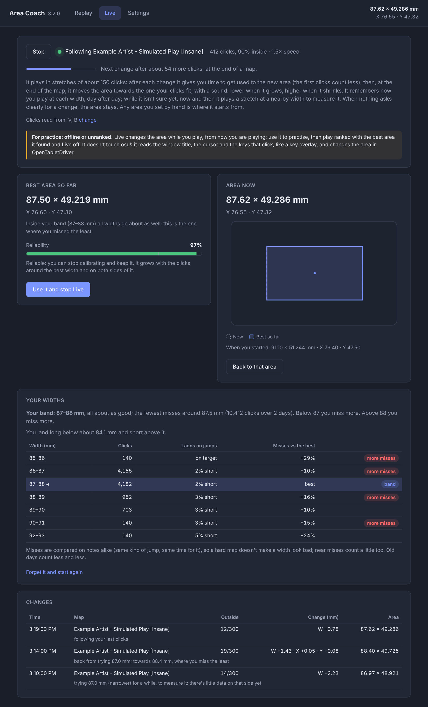
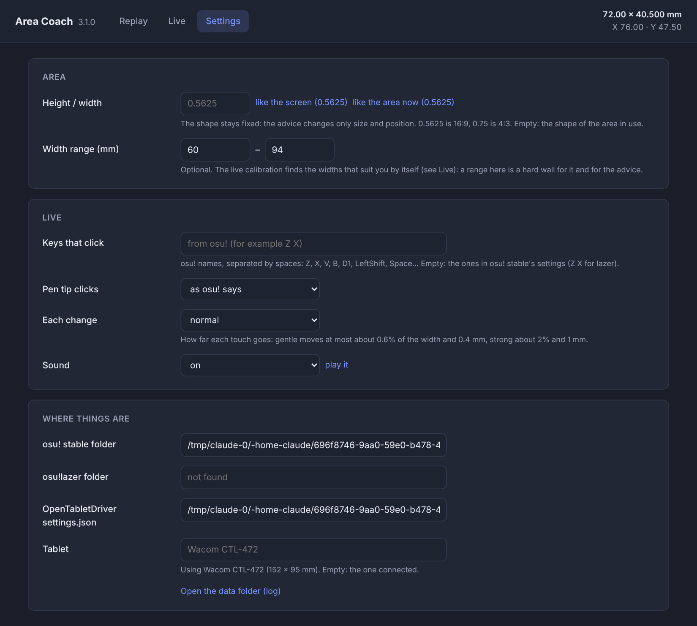

# Area Coach

**Area Coach finds the tablet area for osu! (stable and lazer) from how you really aim.**
It has two sections:

- **Replay**: as soon as you finish a map, it reads the replay osu! just saved and tells
  you how to move and resize your area. One button puts it in OpenTabletDriver.
- **Live**: for practice. While you play, it reshapes the area a little at a time, with
  a soft sound at every touch, like sculpting. It remembers how you play at each width,
  day after day, and finds by itself the band of widths that suit you.

The Replay advice comes from one play alone, worked out with plain geometry. Live adds a
memory of how each width went for you, so that it settles where you miss the least.


- [How the advice is worked out](#how-the-advice-is-worked-out)
- [The Replay section](#the-replay-section)
- [The Live section](#the-live-section)
- [Settings](#settings)
- [What it reads and changes](#what-it-reads-and-changes)
- [Requirements and install](#requirements-and-install)
- [Troubleshooting](#troubleshooting)
- [Build from source](#build-from-source)
- [License and credits](#license-and-credits)

## How the advice is worked out

1. **Every click of the play.** For each circle and slider head: where the circle was,
   how big it was, and where your pen was on the tablet when you pressed (from the
   cursor in the replay and the area you played with).
2. **Every candidate area.** Your height / width ratio stays fixed, your rotation too;
   the width can be anything in your width range, the area anywhere on the tablet. For
   each candidate, the circles are put on the tablet where that area would put them,
   just as big as you had them, and it counts how many of your pen presses land inside.
3. **The best one.** The area with the most presses inside the circles. Among areas
   about as good, the one with the presses closest to the centres: if you always press a
   little to the right of the circles, the area moves so that your presses land on the
   centre. Misses always weigh far more than that: moving a hundred presses from 0.6 to
   0.4 of the radius from the centre is worth one circle hit, and the advice never has
   more misses than the area you played with.
4. **How sure.** The same search is done again on the clicks drawn at random from the
   play: how much the answer moves is the "±" shown. Changes smaller than that are only
   noise of that one map, so the advice says to keep the area (the numbers are still
   shown). If the notes of a map are all in one part of the screen they can't tell the
   width: then only the position is changed.

Presses far from any circle (more than two radii away) don't pull the area, and a map
given up halfway (pen lifted, or pressing anywhere until the end) counts only up to where
you stopped.

The advice assumes your hand makes the same movements with the new area. Change it, play
another map, and see what the next replay says.

## The Replay section

Play a map to the end in osu! or osu!lazer. When the replay is saved (osu! saves one for
every map you finish), the advice appears at once:

- what to change, in words: *Make it 1.20 mm wider, then move it 0.80 mm right and 0.30
  mm up*;
- the area you played with and the suggested one, number by number, as OpenTabletDriver
  writes them;
- the clicks outside the circle with your area and with the suggested one (same
  movements), where you press around the circles on average, and how sure it is;
- the two areas drawn on your tablet and all your presses drawn around a circle.

**Put this area in OpenTabletDriver** applies it; **Go back** returns to the area before.
Only the play just made counts: replays saved before you opened the program are left
out, unless you press **Analyse my latest replay**, which takes the newest replay there
is (useful when you open Area Coach after playing).

The area of each click is the one that was in use at that moment: Area Coach follows the
area in OpenTabletDriver while it is open, so any area you set, by hand or with a
button, counts for the clicks made with it.

This section only reads the replay file osu! saves after a map, and changes the area only
when you press the button: the same as setting it by hand in OpenTabletDriver.

## The Live section



Press **Start live calibration** and play. Area Coach:

- reads the map you are playing from the osu! window title (stable and lazer), and finds
  it in your songs;
- notes every press of the keys that click (the ones in osu!'s settings, for example V and
  B) with the cursor position, a thousand times a second;
- lines the presses up with the circles of the map, finding by itself the speed (DT,
  HT, and any speed in lazer), Hard Rock, pauses and retries;
- every 30 clicks fits the area to your last 150 clicks (as above) and moves the area
  part of the way there: with *normal*, at most about 1.2% of the width and 0.6 mm per
  change. Each change plays a sound: lower when the area grows, higher when it shrinks,
  in between when it only moves.

It starts from whatever area is set, and an area you set by hand while it runs is where
it goes on from. At the end of every map the area is saved in OpenTabletDriver's file;
**Back to that area** returns to the area you had when you started.

### Your widths: the band it finds by itself

Following your last clicks alone, Live could keep shrinking (or growing) the area: if you
land short on fast jumps, it shrinks it; and a smaller area may line up better with your
hand while you miss more, because every bit of shake of the hand becomes more pixels. So
Live also remembers, for each millimetre of width you played:

- **how you land on jumps**: long or short, and by how much;
- **your misses, compared on notes alike**: the same kind of jump with the same time
  for it, so that a hard map doesn't make a width look bad. Near misses count a little
  too: that way a few maps are enough, instead of thousands of clicks.

A width is judged only when there are at least about 60 clicks and three different maps
around it: one map can just be easy. From that it finds:

- **your band**: the widths that go about as well as the best one. Inside it, Live moves
  freely, as before. Past its edges it goes only a little (about 1-1.5 mm), with half
  steps, slower still where the misses are seen to grow that way; if they really grow,
  that edge becomes a wall and the area comes back. If it goes well out there, the band
  stretches: it is elastic, and follows you as your hand changes;
- **where you go from long to short**: if you land long below a width and short above
  it, it heads there instead of bouncing back and forth;
- **habits**: if you land short (or long) by about the same share at every width, the
  area isn't what causes it, and shrinking would only follow you: it stops chasing it
  and tells you so.

The changes get finer as it learns (about half the size once it knows you well), and
widths it hasn't measured yet are crossed with smaller steps, so that they get measured.
The memory is kept per tablet and per shape of area, across days: a day counts half
after 10 days and is forgotten after 60. The maps you finish with Live off count too
(through their replays). **Your widths** shows it all, and **Forget it and start again**
clears it.

**For practice: offline or unranked.** Live changes the area while a map is played, from
how you are playing it: use it to practise, then play ranked with the area it found and
Live off. It doesn't touch osu!: it reads the window title, the cursor and the keys that
click, like a key overlay, and changes the area in OpenTabletDriver.

## Settings



- **Height / width**: the shape of the area, kept fixed (0.5625 is 16:9, 0.75 is 4:3).
  Empty: the shape of the area in use.
- **Width range**: optional. Live finds the widths that suit you by itself; a range here
  is a hard wall for it and for the advice.
- **Keys that click** (Live): empty takes them from osu! stable's settings (Z and X for
  lazer). **Pen tip clicks**: whether the pen tip (a mouse button) counts as a press.
- **Each change** (Live): gentle, normal or strong. **Sound**: on or off.
- **Where things are**: the osu! and osu!lazer folders, OpenTabletDriver's
  `settings.json` and the tablet, when they aren't found by themselves.

## What it reads and changes

- **Reads**: the replays osu! saves (`Data/r` for stable, the files folder for lazer),
  your maps, osu!'s settings (resolution, window, keys), OpenTabletDriver's settings.
  In Live also the osu! window title and position, the cursor position and which keys
  are held.
- **Changes**: only the area of your tablet profile in OpenTabletDriver, when you press
  a button or while Live runs. It sets it in the running OpenTabletDriver and in its
  `settings.json` (a copy of the original, `settings.json.areacoach-backup`, is kept the
  first time).
- Nothing is sent anywhere. Its own files (settings, the memory of your widths in
  `calibration.json`, a log) are in `%APPDATA%\AreaCoach`.

## Requirements and install

- Windows 10 or 11
- [OpenTabletDriver](https://opentabletdriver.net) 0.6, in absolute mode
- osu! stable or osu!lazer
- The Microsoft Edge WebView2 Runtime (part of Windows 11; without it the interface opens
  in the browser)

Download `AreaCoach.exe` from the Releases page and start it: there is nothing to
install.

## Troubleshooting

- **The Replay section keeps waiting.** osu! saves a replay only for maps you finish. If
  osu! is in an unusual folder, set it in Settings.
- **"I can't find the map"**: a map downloaded a moment ago is found once Area Coach has
  read the Songs folder again (a few seconds); in lazer, once its files are read.
- **Live stays on "Lining up"**: check *Keys that click* in Settings (the log shows the
  keys it reads). Relax, Autopilot and mods that mirror or move the circles can't be
  lined up.
- **OpenTabletDriver doesn't answer**: start it. Without it the area is still written in
  its file, and it takes it when it starts.
- **The OpenTabletDriver window shows old numbers**: press *Reopen the OpenTabletDriver
  window* after applying.

## Build from source

Requires Go 1.24 or newer.

```sh
# Windows exe (from any OS)
GOOS=windows GOARCH=amd64 CGO_ENABLED=0 go build -trimpath -ldflags "-s -w -H windowsgui" -o AreaCoach.exe .
```

Add `-X areacoach/internal/server.Version=X.Y.Z` to `-ldflags` to stamp the version.
`rsrc_windows_amd64.syso` holds the Windows icon and manifest, built from `build/`:

```sh
go run github.com/akavel/rsrc@latest -manifest build/app.manifest -ico build/icon.ico -o rsrc_windows_amd64.syso
```

Run the tests with `go test ./...`: they include a simulated player for the Replay
section, one for Live (with a fake OpenTabletDriver), and players of different kinds for
the memory of the widths (one who misses more below a width, one whose hand wants a
smaller area, one who needs a bigger one, one who always lands short), about half a
minute in all.

Pushing a tag like `v3.1.0` makes the *Release* workflow build `AreaCoach.exe` and attach
it, with its checksum, to the GitHub release.

### Layout

| Path | Contents |
| --- | --- |
| `internal/aim` | Judging the clicks of a play, and the search for the area |
| `internal/live` | Following a map while it is played: presses, lining up, sounds |
| `internal/calib` | The memory of your widths: the band, long and short, habits |
| `internal/app` | Replays, the area in OpenTabletDriver, the Live section, settings |
| `internal/geom` | From osu! pixels to the screen and the tablet |
| `internal/osu` | Readers for maps, replays (stable and lazer), `osu!.db`, the settings and osu!lazer's files |
| `internal/otd` | OpenTabletDriver settings and its connection |
| `internal/platform` | Windows: the osu! window, cursor, keys, sound |
| `internal/server`, `web` | The local interface |

## License and credits

[MIT](LICENSE).

Written by **Claude (Opus 5.5)**, Anthropic's AI model, under the direction of the
project author.

Not affiliated with osu!, ppy or OpenTabletDriver.
